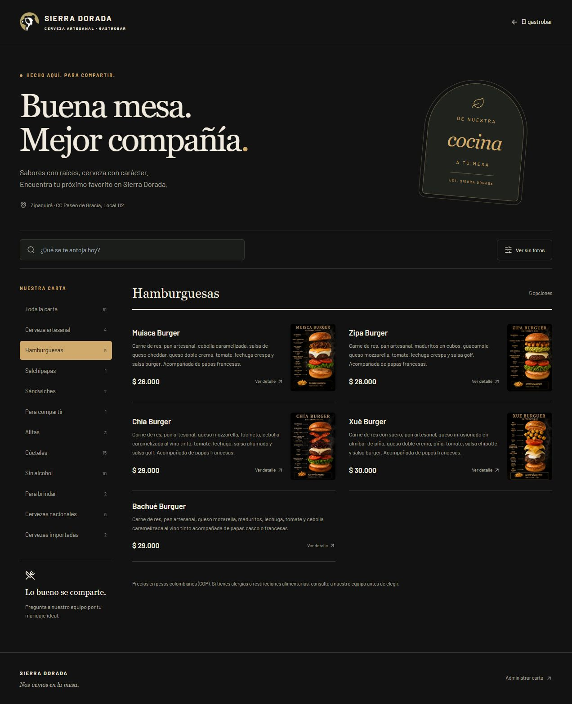

# menuSD

Menú digital independiente del Gastrobar Sierra Dorada. Incluye la carta pública responsive, buscador, categorías, productos con o sin fotografía, panel CRUD protegido, disponibilidad diaria, recetas internas, QR permanente y descarga de la tarjeta para mesas.

Este repositorio contiene solamente el sistema del menú. No incluye la tienda de cerveza, carrito de compras, reservas, chatbot ni las demás páginas corporativas.

## Enlaces actuales

- Carta pública: <https://gastro.sierradorada.co/gastrobar/menu>
- Administración: <https://gastro.sierradorada.co/admin/gastrobar>
- URL permanente codificada en el QR: <https://gastro.sierradorada.co>



## Funciones

- Carta oscura adaptable a celular y escritorio.
- Búsqueda sin distinguir mayúsculas ni tildes.
- Filtro por categorías.
- Opción de mostrar u ocultar fotografías.
- Detalle de cada producto y estado de agotado.
- CRUD de productos y categorías.
- Campos privados para costo, códigos de extras y ficha de receta.
- Inicio de sesión administrativo con contraseña cifrada mediante `scrypt`.
- Sesiones JWT de ocho horas y límite de intentos de acceso.
- Fotografías por archivo local, URL HTTPS o carga PNG/JPEG/WebP.
- QR permanente en PNG y SVG.
- Tarjeta de mesa completa descargable en PNG e impresión directa.
- Catálogo inicial de 73 registros, sin costos ni credenciales en Git.

## Tecnología

- React 18, TypeScript y Vite.
- Express y PostgreSQL.
- Nginx para servir la SPA y redirigir `/api`.
- Docker Compose para ejecutar base de datos, inicialización, API y frontend.

## Inicio rápido con Docker

1. Copia `.env.example` como `.env`.
2. Cambia `DB_PASSWORD` y genera un `MENU_JWT_SECRET` aleatorio.
3. Ejecuta:

```bash
docker compose up -d --build
```

4. Crea o actualiza el administrador, usando valores temporales que no se guardan en Git:

```bash
docker compose run --rm \
  -e MENU_ADMIN_EMAIL=correo@ejemplo.com \
  -e MENU_ADMIN_PASSWORD='una-contraseña-de-12-o-mas-caracteres' \
  setup node server/menu/setup.js --admin
```

5. Abre <http://localhost:8080/gastrobar/menu>.

El volumen `menu_sd_postgres` conserva categorías, productos y administradores entre reinicios.

## Desarrollo local

```bash
npm install
cp .env.example .env
npm run db:seed
npm run api
npm run dev
```

Vite envía `/api` a `http://localhost:3001`. La API requiere PostgreSQL y las variables `DB_*` del archivo local `.env`.

## Rutas

| Ruta | Acceso | Función |
| --- | --- | --- |
| `/gastrobar/menu` | Público | Carta para clientes |
| `/admin/gastrobar` | Administrador | CRUD y descargas del QR |
| `/api/menu` | Público | Categorías y productos publicados |
| `/api/menu/session` | Público | Inicio de sesión administrativo |
| `/api/menu/admin/*` | JWT | Operaciones administrativas |

## Documentación

- [Identidad visual y paletas](docs/IDENTIDAD_VISUAL.md)
- [Arquitectura y modelo de datos](docs/ARQUITECTURA.md)
- [Despliegue y QR permanente](docs/DESPLIEGUE.md)

## Datos incluidos

`server/menu/seed.json` contiene el catálogo inicial que permite levantar una copia funcional. Los costos se eliminaron y los campos internos de Toteat se limpiaron antes de publicar el repositorio. Las cuatro fichas de hamburguesas conservan sus descripciones, recetas e imágenes porque forman parte del menú entregado.

## Comandos

| Comando | Uso |
| --- | --- |
| `npm run dev` | Frontend local |
| `npm run api` | API local |
| `npm run db:seed` | Crear tablas e importar catálogo inicial |
| `npm run db:admin` | Crear o cambiar un administrador |
| `npm run menu:import -- archivo.csv.txt` | Convertir una exportación tabulada de Toteat |
| `npm test` | Pruebas de validación, importación y API |
| `npm run lint` | Revisión estática |
| `npm run build` | Compilación de producción |

No confirmes `.env`, contraseñas, secretos JWT, copias de producción ni exportaciones privadas de Toteat.
